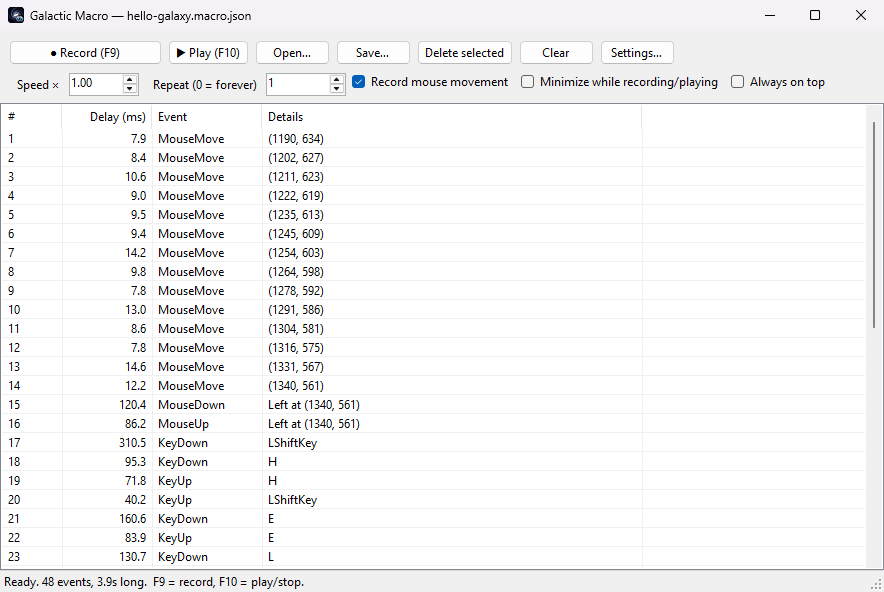
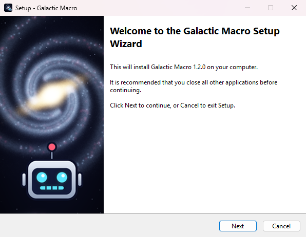
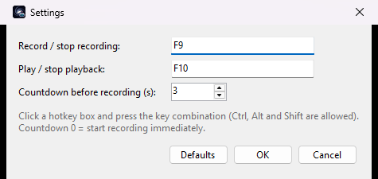
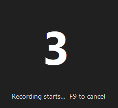

# Galactic Macro

Records mouse and keyboard input system-wide and plays it back with the original timing.
Windows-only, C# / WinForms, .NET 8, no third-party dependencies.

## Screenshots



| Installer | Settings | Countdown before recording |
|---|---|---|
|  |  |  |

## Download

1. Download `GalacticMacro-Setup-*.exe` from the [latest release](https://github.com/xoGUYFAWKSxo/galactic-macro/releases/latest).
2. Run it and click through the wizard. It installs for your user account without needing admin rights, adds a
   Start menu entry and (unless you untick it) a desktop shortcut, and can be removed from **Settings → Apps**.

Everything the app needs is included; you don't have to install .NET. The installer isn't code-signed, so
SmartScreen may warn — choose **More info → Run anyway**.

Prefer no installer? The release also has a portable `GalacticMacro-*-win-x64.zip`: extract it and run
`GalacticMacro.exe`. That version needs the [.NET 8 Desktop Runtime](https://dotnet.microsoft.com/download/dotnet/8.0) (x64).

To run from source instead, see [Build](#build).

## Use

| Action | Button | Default hotkey |
|---|---|---|
| Start / stop recording (or cancel the countdown) | ● Record | **F9** |
| Play / stop playback | ▶ Play | **F10** |

- **Settings…** – change either hotkey (any key, optionally with Ctrl / Alt / Shift) and the
  countdown before recording (0–60 s, default 3; 0 = start immediately). Saved to
  `%APPDATA%\GalacticMacro\settings.json`.
- **Countdown** – a large click-through number appears on the monitor your mouse is on, so you can
  switch to the target app before recording begins. Press the record hotkey again to cancel.
- **Speed ×** – playback speed multiplier (2 = twice as fast).
- **Repeat** – number of loops; `0` loops until you press the play hotkey.
- **Record mouse movement** – untick to record only clicks, wheel and keys (clicks still remember where they happened, so the cursor jumps there).
- **Minimize while recording/playing** – gets the window out of the way.
- **Open… / Save…** – macros are plain JSON (`*.macro.json`), easy to hand-edit.
- **Delete selected** (or the Delete key) removes events; their delay is folded into the next event so timing after them is preserved.
- Starting a new recording when one exists asks whether to append or replace.

Notes:
- The hotkeys are swallowed globally while the app is running so they never leak into the recording.
  Modifier keys pressed as part of a hotkey (e.g. the Ctrl in Ctrl+F9) are stripped from the recording too.
- Clicks and keystrokes aimed at the Galactic Macro window itself are not recorded.
- If playback is stopped mid-macro, any keys or mouse buttons it was holding down are released.
- Windows blocks input into apps running as Administrator from a non-elevated process. To automate an elevated app, run Galactic Macro as Administrator too.
- Games that read raw mouse deltas may not respond to absolute cursor moves.

## Build

Needs the .NET 8 SDK.

```
dotnet run                               # build and launch
dotnet publish -c Release -o publish     # portable build in publish\ (git-ignored)
```

`installer\build.ps1` builds the installer, `dist\GalacticMacro-Setup-<version>.exe`. It needs
[Inno Setup 6](https://jrsoftware.org/isinfo.php) (`winget install JRSoftware.InnoSetup`) and takes the version from
`<Version>` in `GalacticMacro.csproj`. The app is published self-contained, so the installer bundles the .NET runtime.

The app icon (`assets/icon.png`, `assets/icon.ico`) and the installer's wizard images are generated by `assets/make_icon.py` (needs Python with NumPy and Pillow).

## Support

Galactic Studio makes free, open-source Windows tools. If this one is useful to you, a donation helps keep them going.

<a href="https://www.paypal.com/donate/?hosted_button_id=KK7CBMCLSJHWW"></a>

## License

[MIT](LICENSE)
